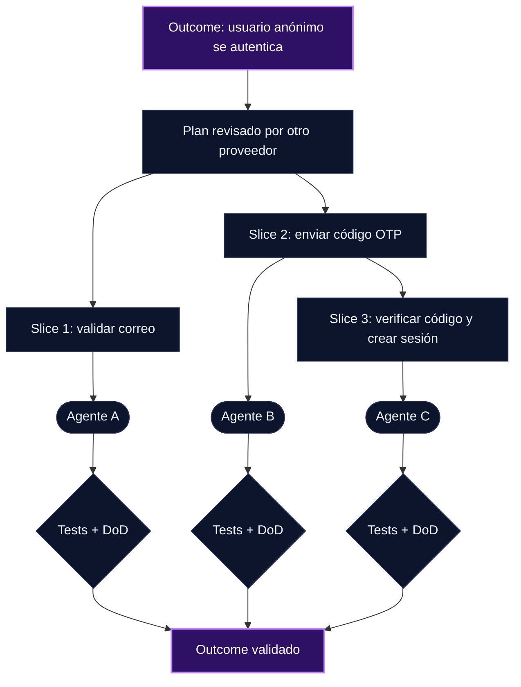

USD 1.61. Eso fue lo que [Pioneer AI & Data](https://pioneeraidata.com/blog/ai-maintenance-cost-small-business) gastó en modelo durante dos meses con dos agentes programados, en 508 ejecuciones. En esos mismos dos meses, la cantidad de cosas que tenían que mantener funcionando pasó de 13 a 50.

Otra agencia, [Oase Creative](https://oasecreative.nl/en/knowledge-base/what-an-agent-system-costs-to-maintain), midió 134 días de operación de su sistema de agentes. En 54 de cada 100 días algo necesitó atención humana. La factura llegó en atención, no en euros.

Los tokens son la línea barata del presupuesto. Lo caro es el tiempo de atención que tengo que dedicar: cada vez que tengo que mirar, revisar, corregir o redirigir a un agente.

## Gobernanza vs. autonomía

Por un lado queremos gobernanza. Queremos mantener el control, así que agregamos guardrails, revisiones, hooks. Por otro lado queremos autonomía: que el agente termine el trabajo sin supervisión.

Al inicio ambas cosas parecen contradictorias. A medida que agregamos más control, el agente requiere más de nuestra atención, más supervisión constante y más steering.

Lo viví en mi primer intento de crear mi propio harness orquestador. Quería un flujo autónomo pero seguro, así que puse guardrails:

- Bloquear cualquier tarea en la que el agente no estuviera seguro.
- Bloquear tareas que necesitaran credenciales.
- Pedir confirmación antes de desplegar a producción.
- Hacer triage de mi intent para decidir si la tarea se podía ejecutar de forma autónoma o necesitaba un plan o diseño.

Durante la implementación tuve que hacer steering: el agente implementó cosas que yo no había considerado. Y cuando empecé a usarlo aparecieron inconsistencias entre agentes. Un agente aprobaba una tarea para ejecución y el agente que implementaba decidía que no estaba lista, la bloqueaba y la mandaba a revisión. Pasaba más tiempo corrigiendo mi harness que haciendo shipping de código.

## Por qué el steering es caro

El steering usualmente llega tarde. El agente ya implementó el feature y se desvió (drift) de la idea original. Ahora hay que corregir, y el agente no solo tiene que entender el contexto nuevo: también tiene que entender lo que ya está implementado, decidir cómo corregirlo de manera segura e iterar más. Cada vuelta pide más atención.

Los planning agents o planning modes son la herramienta habitual para asegurar que la implementación vaya de acuerdo a nuestra intención. Pero los agentes pueden alucinar, y revisar un plan puede ser una tarea que demanda mucha atención antes de poder ejecutarlo de forma segura y evitar drifts.

Y no termina ahí. Una vez implementado el plan, hay que asegurar que el resultado esté alineado con él. Para eso primero necesito entender bien el plan y las especificaciones que se generaron.

> ⚠️ **Gotcha**: un plan largo no elimina la atención, la mueve. Si no entiendo el plan, no puedo validar la implementación contra él.

Un ejemplo concreto: necesitaba agregar a un sistema una interfaz simple para editar los archivos de contexto en markdown. Terminó en una migración del sistema para integrar un editor dentro de él, en lugar de una aplicación simple para editar los archivos `.md`.

## Cómo aseguro que el plan esté bien definido antes de ejecutarlo

La pregunta real es: ¿cómo aseguramos que los planes estén bien definidos y alineados al resultado que queremos crear? Estas son las estrategias que aplico antes y durante la creación del plan.

### 1. Revisión adversaria, idealmente con otro proveedor y modelo

Antes de que se escriba una línea de código, le paso el plan (no el código) a otro agente con el encargo explícito de encontrarle huecos. Prefiero que sea de otro proveedor y otro modelo, porque así captura gaps que el agente original no vio. El mismo modelo tiende a validar sus propios supuestos.

Por ejemplo, puedes usar un modelo de OpenAI para generar el plan, Claude Opus para revisar ese plan y Grok para implementarlo, o la combinación que sea más efectiva para tu flujo de trabajo.

Para esto uso [agent-fabric](https://github.com/ericmaster/agent-fabric), un CLI que instala los mismos agentes portables en OpenCode, Kilo, Codex, Claude Code y otras herramientas, con el modelo de cada proveedor definido por adapter, así que puedo asignar un proveedor distinto al rol que planea y al que revisa.

### 2. Planes simples, limitados a un outcome de valor

El SDLC clásico se enfocaba en features y en la solución. Los LLMs aprendieron de un mundo donde escribir código era caro, y por eso sugieren adherirse a esas prácticas. Con IA iteramos mucho más rápido, así que conviene hacer planes cortos e iterar sobre el outcome.

El error común es planear desde la solución que tenemos en mente y no desde el outcome. El agente encuentra gaps y what-ifs, agrega features que no pensamos y terminamos con planes gigantes que demandan mucho tiempo de revisión.

### 3. Use cases traducidos a test cases

Más importante que la especificación es definir el outcome por medio de test cases que un agente de testing pueda validar después. La especificación describe lo que creo que quiero. El test case define cuándo está terminado, y eso lo puede verificar otro agente sin pedirme atención.

Por ejemplo, en un sistema de autenticación, un use case puede ser: un usuario anónimo entra al sitio y debe autenticarse antes de usar un servicio. De ahí salen test cases como estos:

- Ingresa un correo electrónico válido → `assert('email_valid', true)`
- Ingresa un correo electrónico inválido → `assert('email_valid', false)`
- Ingresa un correo válido y el usuario existe → `assert('send_otp_code', true)`
- Ingresa un correo válido y el usuario no existe → `assert('send_otp_code', false)`, `assert('autenticado', false)` y `assert('response_message', 'Si el correo está registrado, recibirás un código')`, el mismo mensaje que ve un usuario que sí existe, para no revelar qué cuentas existen
- Ingresa un código válido → `assert('autenticado', true)`
- Ingresa un código inválido → `assert('autenticado', false)` y `assert('error_message', 'Código inválido o expirado')`

### 4. Fases en vertical slices, no en módulos

Divido las fases y tareas en vertical slices en lugar de módulos o features horizontales. Cada slice se puede delegar y probar end-to-end de forma independiente, y cada una tiene una Definition of Done clara. Si una slice se desvía, el daño queda contenido en esa slice.

### 5. Visualizar el flujo y la arquitectura

Leer un plan en texto es caro. Verlo es más barato. Uso herramientas de visualización, como mi [artifacts-manager](https://artifacts-manager.ericmaster.ninja), para ver el flujo, la topología de la arquitectura y los componentes antes de aprobar.

## Tradeoffs

Nada de esto es gratis:

- La revisión adversaria con otro proveedor suma costo de tokens y latencia. Lo acepto porque los tokens son lo barato.
- Los planes cortos implican más ciclos. Si el outcome no está claro, iterar rápido solo produce drift más rápido.
- Los test cases solo protegen lo que cubren. Un outcome mal definido en tests es igual de malo que uno mal definido en prosa.
- Las vertical slices cuestan más al principio cuando la base del sistema todavía no existe.

## Siguiente paso

Si hoy estás pasando más tiempo corrigiendo agentes que revisando resultados, prueba esto en tu próximo feature:

1. Escribe el outcome en una frase.
2. Tradúcelo a 3 a 5 test cases.
3. Pide el plan, pásalo por un revisor de otro proveedor.
4. Córtalo en vertical slices con DoD.
5. Míralo antes de aprobarlo.

La pregunta que sigo sin cerrar: ¿cuánta gobernanza puedo mover a validaciones automáticas antes de que esas validaciones se conviertan en otra cosa que tengo que mantener? Oase lo vivió: casi un tercio de sus fallas fueron su propio quality gate rechazando trabajo. Me interesa saber cómo lo estás resolviendo tú.
