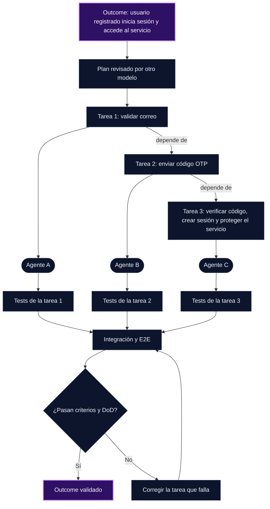

USD 1.61. Eso registró [Pioneer AI & Data](https://pioneeraidata.com/blog/ai-maintenance-cost-small-business) en consumo de modelo durante dos meses para dos agentes programados que clasifican correo, en 508 ejecuciones. Seis de esas ejecuciones no registraron costo, así que la cifra real es apenas un poco mayor. En paralelo, su inventario total de agentes y servicios que tiene que mantener funcionando pasó de 13 a 50. Su autor aclara que no midió sus propias horas lo suficiente como para publicar un número.

Otra agencia, [Oase Creative](https://oasecreative.nl/en/knowledge-base/what-an-agent-system-costs-to-maintain), siguió 134 días de ejecuciones programadas de su sistema de agentes. Registró algún fallo en 72 de 133 días evaluables, el 54 %. Es un indicador de carga operativa, aunque no mide directamente las intervenciones ni las horas humanas. Ellos mismos lo resumen así: la factura llega en atención, no en euros.

En mi flujo, la atención es el costo que más me interesa reducir: cada vez que tengo que mirar, revisar, corregir o redirigir a un agente.

Esos casos describen mantenimiento operativo. Aquí me concentro en otra fuente de atención: dirigir agentes durante el desarrollo y corregir desviaciones del alcance. Uso tres términos de forma consistente: *steering* es redirigir al agente mientras trabaja; *drift* es la desviación entre lo que implementa y lo que yo quería; *outcome* es el resultado verificable que busco, no la solución que imagino.

## Gobernanza vs. autonomía

Por un lado queremos gobernanza. Queremos mantener el control, así que agregamos guardrails, revisiones, hooks. Por otro lado queremos autonomía: que el agente termine el trabajo sin supervisión.

Al inicio ambas cosas parecen contradictorias. Pero no todo control cuesta lo mismo. Cuando cada control termina en una aprobación humana, aumentan las interrupciones. Los controles automáticos, como tests, criterios de aceptación o una Definition of Done (DoD) que otro agente verifica, pueden reducirlas, aunque también necesitan mantenimiento.

Lo viví en mi primer intento de crear mi propio harness orquestador. Quería un flujo autónomo pero seguro, así que puse guardrails:

- Bloquear cualquier tarea en la que el agente no estuviera seguro.
- Bloquear tareas que necesitaran credenciales.
- Pedir confirmación antes de desplegar a producción.
- Clasificar mi petición para decidir si podía ejecutarse directamente o necesitaba un plan o diseño.

Durante la implementación tuve que hacer steering: el agente amplió el alcance con cosas que yo no había considerado, sin validarlas conmigo. Y cuando empecé a usarlo aparecieron inconsistencias entre agentes. Un agente aprobaba una tarea para ejecución y el agente que implementaba decidía que no estaba lista, la bloqueaba y la mandaba a revisión. Pasaba más tiempo corrigiendo mi harness orquestador que entregando código.

Agregar otro revisor no resolvía esa discrepancia. El problema era que cada agente aplicaba su propio criterio. Lo que necesitaba era una regla compartida: los mismos criterios de aceptación deciden cuándo una tarea se ejecuta, cuándo se detiene y cuándo se escala. Si los agentes siguen sin ponerse de acuerdo, decido el mejor acercamiento de acuerdo a mi experiencia.

## Por qué el steering es caro

El steering usualmente llega tarde. El agente ya implementó la funcionalidad y hay drift respecto a la idea original. Ahora hay que corregir, y el agente no solo tiene que entender el contexto nuevo: también tiene que entender lo que ya está implementado, decidir cómo corregirlo de manera segura e iterar más. Cada vuelta pide más atención.

Los planning agents o planning modes son la herramienta habitual para asegurar que la implementación vaya de acuerdo a nuestra intención. Pero los agentes pueden alucinar, y revisar un plan puede ser una tarea que demanda mucha atención antes de poder ejecutarlo de forma segura y evitar drift.

Y no termina ahí. Una vez implementado el plan, hay que asegurar que el resultado esté alineado con él. Para eso primero necesito entender bien el plan y las especificaciones que se generaron.

> ⚠️ **Gotcha**: un plan largo no elimina la atención, la mueve. Si no entiendo el plan, no puedo validar la implementación contra él.

Un ejemplo concreto: necesitaba una interfaz simple para editar los archivos de contexto en markdown de un sistema. Lo que yo tenía en mente era una aplicación aparte para editar los archivos `.md`. Terminó en una migración del sistema para integrar un editor dentro de él. No había sido explícito en que la herramienta debía ser independiente y tampoco había verificado con el agente si estábamos en la misma página. El plan resolvió esa ambigüedad por su cuenta.

## Cómo aseguro que el plan esté bien definido antes de ejecutarlo

La pregunta real es: ¿cómo aseguramos que los planes estén bien definidos y alineados al resultado que queremos crear? Estas son las estrategias que estoy usando y evaluando antes y durante la creación del plan.

### 1. Revisión adversaria, idealmente con otro proveedor y modelo

Antes de que se escriba una línea de código, le paso el plan (no el código) a otro agente con el encargo explícito de encontrarle huecos. Pruebo con otro modelo, a menudo de otro proveedor, para buscar puntos ciegos distintos. En mi experiencia, eso ayuda a encontrar huecos que el agente original no vio, pero cambiar de proveedor no garantiza una revisión mejor: evalúo qué errores adicionales detecta y cómo los justifica.

Por ejemplo, puedes usar un modelo de OpenAI para generar el plan, Claude Opus para revisar ese plan y Grok para implementarlo, o la combinación que sea más efectiva para tu flujo de trabajo.

Para esto uso [agent-fabric](https://github.com/ericmaster/agent-fabric), un CLI que instala los mismos agentes portables en OpenCode, Kilo, Codex, Claude Code y otras herramientas, con el modelo de cada proveedor definido por adapter, así que puedo asignar un proveedor distinto al rol que planea y al que revisa.

### 2. Planes simples, limitados a un outcome de valor

En mi experiencia, los planes centrados demasiado pronto en una solución tienden a crecer. Me funcionan mejor los planes cortos, con un resultado verificable y límites explícitos de alcance. Con IA iteramos mucho más rápido, así que conviene planear poco e iterar sobre el outcome.

El error común es planear desde la solución que tenemos en mente y no desde el outcome. El agente encuentra huecos y casos hipotéticos, agrega funcionalidades que no pensamos y terminamos con planes gigantes que demandan mucho tiempo de revisión.

### 3. Use cases traducidos a test cases

Los casos de prueba convierten parte de la especificación en condiciones verificables. Otro agente puede comprobarlas y reducir mi revisión rutinaria; sigue haciendo falta validar que representen el resultado y sus restricciones.

Por ejemplo, en un sistema de autenticación, un use case puede ser: un usuario anónimo entra al sitio y debe autenticarse antes de usar un servicio. De ahí salen test cases como estos:

- Dada una solicitud sin sesión válida, cuando llama directamente al servicio protegido, entonces se rechaza y no entrega datos protegidos.
- Dado un correo con formato inválido, cuando solicito un código, entonces el sistema rechaza la solicitud y no envía ningún código OTP.
- Dado un correo válido de un usuario registrado, cuando solicito un código, entonces el sistema envía un código OTP a ese correo.
- Dado un correo válido que no está registrado, cuando solicito un código, entonces no se envía ningún código, no se crea sesión y la respuesta pública es la misma que para un usuario registrado: "Si el correo está registrado, recibirás un código". Ambos casos devuelven el mismo estado HTTP, sin diferencias de tiempo explotables, para no revelar qué cuentas existen. El envío del código se comprueba internamente.
- Dado un código emitido para esa cuenta, vigente y sin utilizar, cuando lo ingreso, entonces se crea una sesión para esa cuenta y el código queda consumido.
- Dado un código incorrecto, expirado o ya utilizado, cuando lo ingreso, entonces no se crea sesión y la respuesta es "Código inválido o expirado".
- Dado que se superó el límite de intentos, cuando ingreso otro código, entonces se rechaza aunque sea correcto.
- Dada una sesión válida creada tras verificar el código, cuando llamo al servicio protegido, entonces puedo usar el servicio para el que tengo autorización.

El ejemplo no es una guía completa de autenticación: omite otros controles y pruebas.

### 4. Fases en vertical slices, no en módulos

Divido las fases en vertical slices en lugar de módulos o capas horizontales. Cada slice entrega un comportamiento observable de extremo a extremo sobre una base común, tiene una Definition of Done clara y se puede delegar. Explicito sus dependencias y compruebo que no introduzca regresiones. Si una slice se desvía, el drift es más fácil de detectar y revertir, aunque no queda aislado si comparte sesión, base de datos o contratos con otras partes.

En el ejemplo, la primera slice es "usuario registrado inicia sesión y accede al servicio". Validar el correo, enviar el código y verificarlo no son slices: son tareas de ese flujo.

### 5. Visualizar el flujo y la arquitectura

Un diagrama me ayuda a revisar dependencias y alcance más rápido que el texto; lo contrasto con los criterios de aceptación. Uso herramientas de visualización, como mi [artifacts-manager](https://artifacts-manager.ericmaster.ninja), para ver el flujo, la topología de la arquitectura y los componentes antes de aprobar.

En este diagrama, las flechas entre tareas indican dependencias de implementación: una tarea usa lo que construyó la anterior.

## Tradeoffs

Nada de esto es gratis:

- Este flujo también consume atención al preparar criterios, resolver discrepancias y mantener validaciones. Su utilidad depende de que ese esfuerzo sea menor que las correcciones que evita. No tengo datos que lo demuestren todavía; por eso lo presento como una práctica que estoy usando y evaluando.
- La revisión adversaria con otro modelo suma costo de tokens y latencia. En mi caso lo acepto, porque la atención me cuesta más que los tokens.
- Los planes cortos implican más ciclos. Si el outcome no está claro, iterar rápido solo produce drift más rápido.
- Los test cases solo protegen lo que cubren. Si plan, implementación y tests comparten una interpretación equivocada, pueden coincidir perfectamente.
- Las vertical slices cuestan más al principio cuando la base del sistema todavía no existe.

## Siguiente paso

Si hoy estás pasando más tiempo corrigiendo agentes que revisando resultados, prueba esto en tu próxima funcionalidad:

1. Escribe el outcome en una frase.
2. Tradúcelo a 3 a 5 test cases.
3. Pide el plan y pásalo por un revisor con otro modelo.
4. Córtalo en vertical slices con DoD.
5. Míralo antes de aprobarlo.

La pregunta que sigo sin cerrar: ¿cuánta gobernanza puedo mover a validaciones automáticas antes de que esas validaciones se conviertan en otra cosa que tengo que mantener? Oase clasificó casi un tercio de sus ejecuciones fallidas (76 de 241) como rechazos deliberados de su propio control de calidad, y lo describe como el control funcionando según lo previsto. Conviene distinguir esos bloqueos esperados de los falsos positivos y de las fallas del propio control. Me interesa saber cómo lo estás resolviendo tú.
